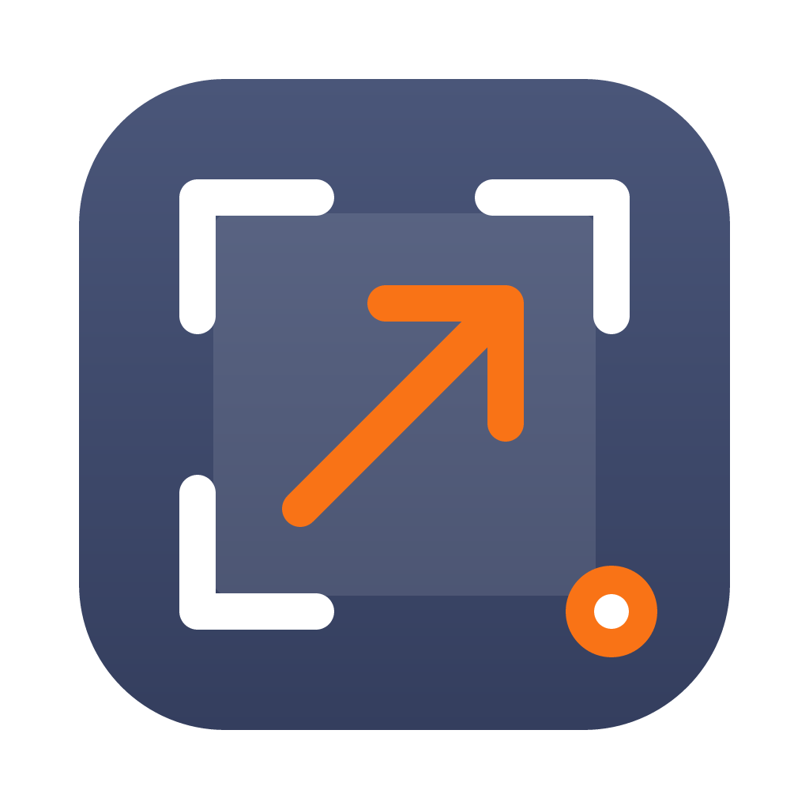

# WE Screenshot

<p align="center"></p>

WE Screenshot is a small native macOS menu bar app for taking screenshots. Press a global shortcut (Shift+Command+9 by default), the screen freezes and dims, and you drag a rectangle over the part you want. You can draw on it (pencil, line, arrow, rectangle, marker, text, colour), and then copy it, save it, print it, upload it to your own Google Drive or search for similar images.

Screenshots stay on your Mac unless you upload them, and uploads go only to your own Google Drive. The only other network use is a daily check for updates on GitHub, which can be turned off. It is made by [White Eagles & Co. s.r.o.](https://whiteeagles.sk/), written in Swift with AppKit and has no third-party dependencies.

## What it does

- **Freeze and select.** The shortcut captures every display at once and shows each one frozen and dimmed. Drag a rectangle on any display; the selection is shown at full brightness with a border, eight handles and a size badge. Move it by dragging inside, resize it by the handles, or press Command+A to select the whole display under the mouse. A plain click outside the selection keeps the selection and the drawings you already made; they are only replaced when you actually drag a new rectangle.
- **Draw on the picture.** Pencil, line, arrow, rectangle, marker and text, in any colour from the system colour panel, with undo. The text tool places an editable box where you click: Return finishes the text, Shift+Return or Option+Return starts a new line, Escape drops the text you are typing.
- **Copy.** Puts the picture on the clipboard as PNG and TIFF, at its on-screen size.
- **Save.** The Save button opens a save panel; Command+S saves at once without a panel into the last used folder (the Desktop at first) and shows a notification. PNG or JPEG, and an option to save Retina screenshots at half size.
- **Print.** Opens the standard print panel with the picture scaled to fit the page.
- **Upload to Google Drive.** The picture goes to the folder "WE Screenshot" in your own Drive, the link is copied to the clipboard and a notification appears (a click on it opens the link). The page can be opened automatically after the upload. This needs a one-time setup, see [Google Drive setup](#google-drive-setup).
- **Search similar images.** Uploads the picture to your Drive and opens Google Lens with its link (see the caveat in [Google Drive setup](#google-drive-setup)).
- **Shortcuts that work on any keyboard layout.** The selection mode shortcuts also work on a non-Latin layout, for example Command+C on a Russian keyboard.
- **Changeable global shortcut.** Set it in Settings; if another app already uses the combination, the app tells you and keeps the previous one.
- **Starts at login** (can be turned off in Settings or in the menu).
- **Updates itself.** Once a day the app asks GitHub Releases whether there is a new version. If there is, it shows what is new and, when you agree, downloads it, checks that it is signed with the same certificate, replaces itself in place and restarts. Settings stay. The check can be turned off, and Check for Updates runs it by hand.
- **Interface** in English, Russian and Slovak.
- **Universal binary** for Apple silicon and Intel Macs.

## Requirements

- macOS 13 or later, on Apple silicon or Intel.
- The Screen Recording permission (System Settings > Privacy & Security > Screen Recording). Without it macOS cannot let the app see the screen.

## Install

1. Download `WE-Screenshot-<version>.zip` from [Releases](https://github.com/JaffarSk24/WE-Screenshot/releases), unzip it and move **WE Screenshot.app** to the Applications folder.
2. The app is signed with a self-signed certificate and is not notarised by Apple, so the first launch needs one confirmation: right click the app and choose Open, or open it and then go to System Settings > Privacy & Security and press **Open Anyway**.
3. Press the shortcut once. The app asks for the Screen Recording permission; switch it on for WE Screenshot in System Settings > Privacy & Security > Screen Recording. macOS may ask you to quit and reopen the app, and on newer systems it may also show its periodic reminder about apps that can record the screen.
4. Later versions install themselves: the app offers each new release and updates in place.

## Usage

The app lives in the menu bar (a viewfinder icon). Its menu has Take Screenshot, the Google Drive sign in and sign out, Settings, Open at login, Check for Updates and Quit.

| Shortcut | Result |
|---|---|
| Shift+Command+9 (changeable in Settings) | Freezes the screen and starts the selection |
| Command+C | Copy the selection |
| Command+S | Quick save, no panel |
| Command+D | Upload to Google Drive |
| Command+P | Print |
| Command+Z | Undo the last drawing |
| Command+A | Select the whole display under the mouse |
| Escape or Command+X | Cancel |
| Arrow keys | Move the selection by 1 point |
| Shift+arrow keys | Resize the selection by 1 point |
| Option with arrows or Shift+arrows | The same, in steps of 10 points |

While a text is being typed the shortcuts above are off, so typing does not trigger them. Actions need a selection and do nothing without one.

Mouse: with no tool active, drag on the dimmed area to start a selection, drag inside it to move it and drag a handle to resize it. With a tool active, drag inside the selection to draw; the handles still resize, and a drag that starts outside the selection starts a new one. Starting a new selection clears the drawings. Click a tool button to choose that tool and click it again to turn it off. Two panels appear next to the selection: tools on the side (pencil, line, arrow, rectangle, marker, text, colour, undo) and actions below it (upload, search similar, print, copy, save, close).

## Google Drive setup

Uploading and "Search similar images" need your own Google OAuth client. Google's OAuth policies forbid publishing client credentials in a public repository, so this app ships without any and every user creates a personal client once. It takes a few minutes.

1. Open https://console.cloud.google.com/auth/overview/personal and sign in with the Google account whose Drive should receive the screenshots. This is the quick setup page for Personal mode: the app works only for this one account, but needs no Google verification, shows no unverified-app warning and does not sign you out every 7 days.
2. Leave the project field on "Create a new project" (the default name is personal-mode-app, you can rename it to WE Screenshot) or pick a project you already created in Personal mode.
3. For Application type choose "Desktop app". If asked for a client name, enter WE Screenshot.
4. Leave "Use this client for an AI-powered agent" unchecked.
5. Accept the Terms of Service and press Continue.
6. In the "OAuth client created" window copy the Client ID and the Client secret, or press Download JSON and keep the file somewhere safe. Google does not show the full secret again after you close the window.
7. Enable the Google Drive API: open https://console.cloud.google.com/apis/library/drive.googleapis.com, check that the same project is selected at the top and press Enable. This step is required if the quick setup reported that some APIs could not be enabled automatically.
8. If the Google Auth Platform menu has a Data Access section, open it, press Add or remove scopes, tick `https://www.googleapis.com/auth/drive.file`, then Update and Save. This is a precaution: Google's documentation does not say whether it is required in Personal mode.
9. In WE Screenshot open Settings, paste the Client ID and the Client secret into the Google Drive box and press Save, then press Sign In. Your browser opens, you approve access, and the app shows the account it is signed in as. The "How to get these" button in Settings opens this section.

If Personal mode is not available (for example a Google Workspace account), use the fallback: create an ordinary project, in Google Auth Platform press Get started, enter the name WE Screenshot and your support e-mail, choose External as the audience, then in Audience press Publish app (status In production). In Clients press Create client, choose Desktop app and copy the Client ID and the Client secret. Do not leave the app in Testing status: in that status Google ends the sign in every 7 days.

What the app asks for: only the `drive.file` scope, which lets the app see only the files it created itself, not the rest of your Drive. Sign in uses your system browser with a loopback address and PKCE.

Where things are stored: the client secret and the sign in tokens live in the macOS keychain, the client ID in the app's preferences. Do not add the ID or the secret to a repository or send them in chats.

An uploaded screenshot is shared with the setting "anyone with the link can view", so anyone who has the link can see it. To stop using Drive, choose Sign Out of Google Drive in the menu or in Settings; the app forgets the tokens. Files already uploaded stay in your Drive and you can delete them there.

"Search similar images" uploads the picture to your Drive first and then opens Google Lens with the link of that file. Google documents neither a direct link to a Drive file as an image nor a link form for Lens, so this relies on link forms that can change, and it may stop working one day.

## Data and settings

- Settings: the `sk.whiteeagles.screenshot` preferences domain (shortcut, image format, Retina option, update options, Google client ID and so on).
- Google client secret and tokens: the macOS keychain, service `sk.whiteeagles.screenshot.google`.
- Google Drive: a folder named "WE Screenshot", created on the first upload, holds the uploaded pictures.

The app writes nothing else. It makes no analytics calls. Network use is limited to Google sign in and uploads, which you start yourself, and the daily check for updates, which reads the latest release from the GitHub API and downloads a new version only when you accept it. The check can be switched off in Settings or in the menu.

## Building from source

You need Xcode 15.2 or later, or the Command Line Tools of a current macOS.

```bash
swift build                 # debug build of everything
tools/test.sh               # unit tests (XCTest); extra arguments go to swift test
tools/make_cert.sh          # once: a local code signing certificate in the login keychain
tools/build_app.sh          # universal app, signed, zipped into build/ and installed into /Applications
tools/build_app.sh --no-install   # the same without installing
```

`tools/build_app.sh` builds an arm64 and an x86_64 binary, joins them with `lipo`, signs the bundle with the certificate "WE Screenshot Local Signing" (override the name with `SIGN_IDENTITY`) and packs `build/WE-Screenshot-<version>.zip`. Without the certificate it signs ad hoc and warns you.

The self-signed certificate matters: macOS ties the Screen Recording permission to the code signature, and the updater accepts a new version only if it satisfies the designated requirement of the running app. With an ad hoc signature the permission is asked for again after every rebuild, and installed copies refuse updates signed with another certificate.

To build releases on another Mac with the same identity, move the certificate there:

```bash
tools/export_cert.sh identity.p12      # on the first Mac, asks for a password
tools/import_cert.sh identity.p12      # on the second Mac
```

`tools/make_icon.sh` renders `Resources/icon/AppIcon.svg` into the icon files.

Developer tools:

- `swift run weshot-harness <folder>` renders the selection screen off screen (no window, no permission needed) into PNG files in the given folder: empty, selection, annotations, edge placement, full display and the composed result. The folder must be outside the project.
- `WEScreenshot --version` prints the version and exits. `WEScreenshot --capture-test <path prefix>` captures all displays, writes each as `<prefix>-<index>.png`, prints one line per display and exits; it is a quick way to check capture and the Screen Recording permission on a real Mac.

Continuous integration (GitHub Actions) builds and tests on Apple silicon runners (macOS 26 and macOS 15) and on an Intel runner, and a separate job builds the universal app bundle and checks that it contains both architectures, is validly signed, has the right bundle identifier and minimum system version, contains the English, Russian and Slovak resources and starts with `--version`.

## Releasing

1. Set the version in `Resources/Info.plist` (`CFBundleShortVersionString`) to X.Y.Z.
2. Build with `tools/build_app.sh`, signed with the same certificate as earlier releases. It produces `build/WE-Screenshot-X.Y.Z.zip`.
3. Create a GitHub release with the tag `vX.Y.Z` and attach the zip under exactly that name, `WE-Screenshot-X.Y.Z.zip`.

The updater compares the tag with the installed version, looks for that exact attachment name, checks that the version inside the app equals X.Y.Z and verifies the signature against the running app. A build signed with a different certificate is refused by installed copies.

## Project layout

- `Sources/WECore`: pure logic: settings, shortcut model, selection geometry, file naming, versions.
- `Sources/WEAnnotate`: annotation model, rendering, image composition and encoding.
- `Sources/WECloud`: Google sign in (OAuth for desktop apps) and Google Drive upload, keychain storage.
- `Sources/WECapture`: screen capture with ScreenCaptureKit and the Screen Recording permission.
- `Sources/WEOverlay`: the selection screen: windows, selection, panels, drawing tools.
- `Sources/WEActions`: copy, save, print, upload, search, notifications and the updater.
- `Sources/WEScreenshot`: the app: menu, global shortcut, settings window, login item.
- `Sources/weshot-harness`: the off screen renderer for the selection screen.
- `Tests`: unit tests for WECore, WEAnnotate and WECloud.
- `Resources`: Info.plist, icon, and the English, Russian and Slovak strings.
- `tools`: certificate, icon, build and test scripts.

## License

The code is released under the [MIT License](LICENSE). Copyright (c) 2026 White Eagles & Co. s.r.o.
